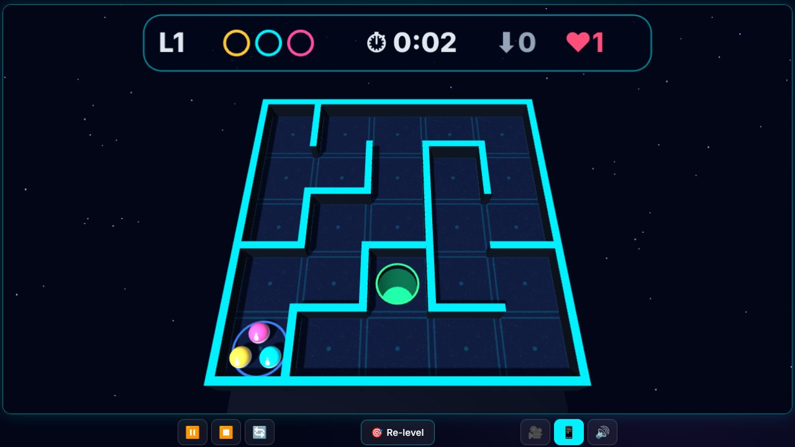

<div align="center">

# 🎱 3D Labyrinth

**Tilt the board to roll three balls through a 3D maze into the goal. Dodge the holes, time the sliding gates, beat the clock. Play flat, or in real stereo 3D and VR.**

[](https://srathinagiri.github.io/3DLabyrinth/)
[](manifest.json)
[](#-3d-and-vr)
[](#-install-as-an-app)
[](https://threejs.org/)
[](LICENSE)

### [▶ Play now in your browser](https://srathinagiri.github.io/3DLabyrinth/)



🪔 *Part of the [Diwali Mega Gift Week 2026](https://srathinagiri.github.io/#gift-week): one free app every day, 6–12 November.*

</div>

---

## 🎮 How to play

1. **Tilt your phone** to tilt the board. The countdown takes the way you are holding it as "flat", so hold it however is comfortable. Tap 🎯 **Re-level** any time.
2. Roll all **three balls** from the blue start ring into the **green goal**.
3. Avoid the **holes**. A ball that falls in goes back to the start, unless you have a ❤ **life** to spend.
4. From level 3 there is a **time limit**. From level 4, **sliding gates** sweep across the corridors.
5. Earn ★★★ with no falls and a fast finish.

**No gyroscope?** Drag on the board like a joystick, or use the arrow keys / W A S D, a gamepad, or a Meta Quest thumbstick.

Levels never end and get bigger (up to 16 × 16). Each level number is a fixed maze, so "Level 7" is the same for everyone.

## ❤ Lives, apples and the route guide

- You start with **1 life** and earn **+1** the first time you clear each level. A life saves a ball from a hole: it hops over to the next safe cell.
- From level 4, each maze hides one 🍎 **bonus apple** at the end of a side branch, behind one obstacle. It gives **+1 life**, once per level.
- If time runs out but your lives cover the balls still out, you are **rescued** and move on.
- 🧭 **Route guide** (`G`, or on the pause panel): shows the way to the goal in green, marks dead ends in red and the apple branch in gold. Using it caps the level at ★★.

## 🪵 Boards and balls

Pick them in the menu. Each one changes both the look and the physics.

| Board | Feel |
|---|---|
| 💠 Neon | Classic arcade board |
| 🪵 Wood | Grippy and forgiving |
| 🧊 Glass | Slippery; you can see the pits through the floor |
| 🏛️ Marble | Quick, with springy walls |

| Ball | Feel |
|---|---|
| 🟡 Plastic | All-rounder |
| ⚙️ Steel | Fast and heavy, keeps its momentum |
| 🔴 Rubber | Slow but bounces off walls |

Slow combinations get extra time on the clock.

## 🎥 Views

Press 🎥 (or `V`) to cycle **Auto → Whole board → Follow → Inside**.

- **Inside** puts the camera at ball height with one ball, steering like a car through towering corridors, with a GPS-style minimap.
- 🗺 (or `N`) switches the map between off, small and large.

## 👓 3D and VR

- **2D**, **Parallel** and **Cross-eye** side-by-side, **Anaglyph** (red/cyan glasses), and **Smart glasses** half-SBS (RayNeo, XREAL, Rokid, TCL).
- The depth adjusts itself to the board size, and all messages appear inside the 3D scene, so they read correctly in every mode.
- **Meta Quest (WebXR):** tap **🥽 VR** in the Quest browser. The thumbstick tilts the board, and `B` / `Y` opens the pause panel, where **☰ Menu** takes you out of VR and back to the main menu. Choose **🤲 Hand-held** (the default: a board held just below eye level and tipped toward you, so you never bow your head) or **🟫 Floor** (a giant maze at your feet). Hand-held not quite right for you? **🎚 Adjust** on the pause panel lets you set it live: push the thumbstick **up/down to raise or lower the board** (−30 to +20 cm) and **left/right to change its tilt** (0–85°), then press the trigger. Your setting is remembered on that headset. The Inside view is not offered in VR, to avoid motion sickness.
- **Smart glasses:** the phone in your hand is the controller. Tilt it to tilt the board. A Bluetooth gamepad also works.

## 📲 Phone as controller

Playing on a TV or smart glasses? Controls → **📲 Phone controller** shows a 6-digit code. Open the link it shows on a phone on the **same Wi-Fi**, enter the code, and tilt the phone to tilt the board.

Pairing uses the free PeerJS signalling server once to introduce the two devices. After that, tilt and button presses go **directly between your devices**, and the game itself stays offline.

## 📲 Install as an app

- **Android (Chrome or Edge):** tap **📲 Install app** in the menu header.
- **iPhone / iPad (Safari):** Share → **Add to Home Screen** (the install button shows the steps).
- **Windows / Mac:** click the install icon in the address bar.

Once installed it works fully offline. No account, no ads, no tracking. On phones, a level goes full-screen and locks the screen rotation, so tilting can't flip it.

---

## 🛠 For developers

<details>
<summary><b>Run, test and release</b></summary>

ES modules need a web server:

```bash
python -m http.server 8086      # then open http://localhost:8086
node --test tests/logic.test.mjs tests/version.test.mjs tests/solvable.test.mjs
```

The gyroscope needs **HTTPS** on real phones (GitHub Pages provides it).

- `logic.test.mjs`: mazes are perfect and deterministic, hurdles never block the path, balls never tunnel through walls, and the hole, respawn and goal logic works.
- `solvable.test.mjs`: a headless autopilot clears levels 1–40 with the real physics (and checks every timer is at least 2.3× a careful per-ball run), plus levels 1–12 on the extreme board/ball pairings.
- `version.test.mjs`: versions agree everywhere, every module is cached, icons are installable, and only approved outside hosts appear in the code.

**Releasing:** bump the version in **all** of `js/config.js` (`VERSION`), `sw.js` (`CACHE_VERSION`), `manifest.json`, `index.html` (badge + `?v=` on the CSS/JS), `controller.html`, and the version badge in this README. Modules load through an import map with `?v=<version>`, and the service worker pre-caches from the network, so an update can never mix old and new code. The service worker only deletes caches named `labyrinth-*`, so other games on the same `github.io` origin keep their offline copies.

</details>

<details>
<summary><b>Exact rules and physics</b></summary>

**Difficulty curve** (`js/config.js`):

| Level | What gets added |
|---|---|
| 1–2 | 5 × 5 maze, no hurdles, untimed |
| 2+ | Side holes in dead-end branches |
| 3+ | Time limit, scaled to the solution path: from about 3.3× down to about 2.4× a careful single-ball run |
| 4+ | Sliding gates across corridors; one 🍎 apple per level |
| 5+ | Holes offset into straight corridors, leaving a narrow lane |
| 8+ | Holes on the outer corner of turns |
| All | The board grows to 16 × 16, and the maximum tilt rises from 9.5° to 16° |

**Stars:** ★★★ = no falls and finished within 66% of the time; ★★ = up to 2 falls; ★ = cleared. A life-saved fall counts as a fall, a rescue gives ★, and using the route guide caps at ★★.

**Board and ball multipliers** (`BOARD_SURFACES`, `BALL_TYPES`):

| Board | Grip | Wall bounce |
|---|---|---|
| Neon | 1.0× | 1.0× |
| Wood | 1.7× | 0.75× |
| Glass | 0.4× | 1.2× |
| Marble | 0.7× | 1.35× |

| Ball | Accel | Grip | Bounce | Top speed |
|---|---|---|---|---|
| Plastic | 1.0× | 1.0× | 1.0× | 1.0× |
| Steel | 1.2× | 0.55× | 0.55× | 1.3× |
| Rubber | 0.85× | 1.6× | 1.7× | 0.85× |

Board and ball values multiply (wall restitution is capped at 0.92). On a real incline a heavy ball does not accelerate faster (a = 5/7 · g · sin θ regardless of mass), so steel's acceleration boost is a gameplay choice. Slow pairings get up to +40% on the timer (`timePace`).

**Apples:** each apple sits at the dead end of a side branch 2–4 cells off the solution route. The cell before it holds exactly one guard (a sliding gate or offset hole on a straight, or a corner hole on a bend). Each level's apple can be claimed once ever (`progress.apples`).

**Inside view:** walls are drawn 3.2× taller (physics unchanged). The camera follows the ball's low-passed velocity, turns at most about 86° per second, and holds when you roll backwards (`INSIDE_VIEW` in `config.js`).

</details>

<details>
<summary><b>Phone-controller security</b></summary>

`js/link.js` and `js/pad.js` use the official PeerJS client 1.5.5 (MIT, bundled unmodified as `js/lib/peerjs.min.js`; provenance in `js/lib/peerjs.LICENSE.txt`). The public signalling server `0.peerjs.com` introduces the devices once, and Google's public STUN server helps them find a route. TURN relays are disabled (STUN only), so game data never passes through a third party. Only whitelisted button actions are accepted, and if tilt messages stop for 0.5 s the board levels out. `tests/version.test.mjs` fails if any other outside host appears in the code.

The 6-digit code (cryptographically random, 900,000 possibilities) is convenience pairing, not strong authentication. A newer phone replaces an older one, and **Disconnect** closes the code.

</details>

<details>
<summary><b>Project structure</b></summary>

```
js/config.js     constants + difficulty curve (pure)
js/maze.js       seeded maze generator, hurdle placement, route guide (pure)
js/physics.js    ball physics: walls, gates, holes, goal (pure)
js/progress.js   saved progress, stars, apples
js/renderer.js   stereo engine (from 3D Tunnel Rush)
js/board.js      three.js scene for a level
js/materials.js  procedural wood / glass / marble / neon textures, ball skins, reflections
js/controls.js   gyro / drag / keys / gamepad / XR → analog tilt
js/hud3d.js      in-scene HUD (works in every stereo mode)
js/audio.js      Web Audio synth
js/ui.js         menus, modals, settings
js/link.js       phone-controller pairing (PeerJS)
js/pad.js        controller.html logic
js/app.js        game loop, camera, level lifecycle, WebXR, service worker
```

</details>

Sister project of [3D Tunnel Rush](https://github.com/SRathinaGiri/3DTunnelRush), whose stereo render pipeline, gyro handling and PWA shell it reuses.

## 📄 License

[MIT](LICENSE) © S. Rathinagiri. three.js and PeerJS are MIT-licensed.
